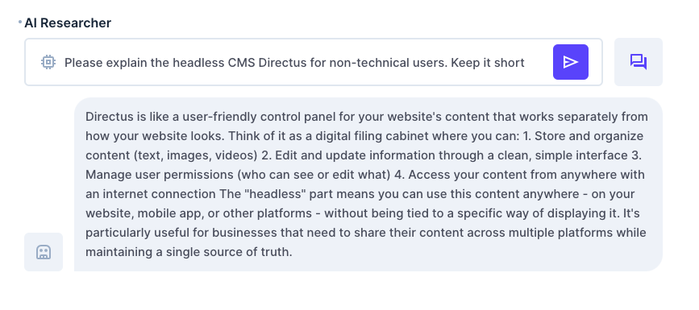
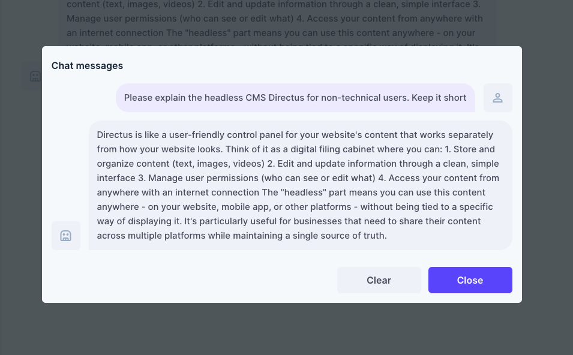
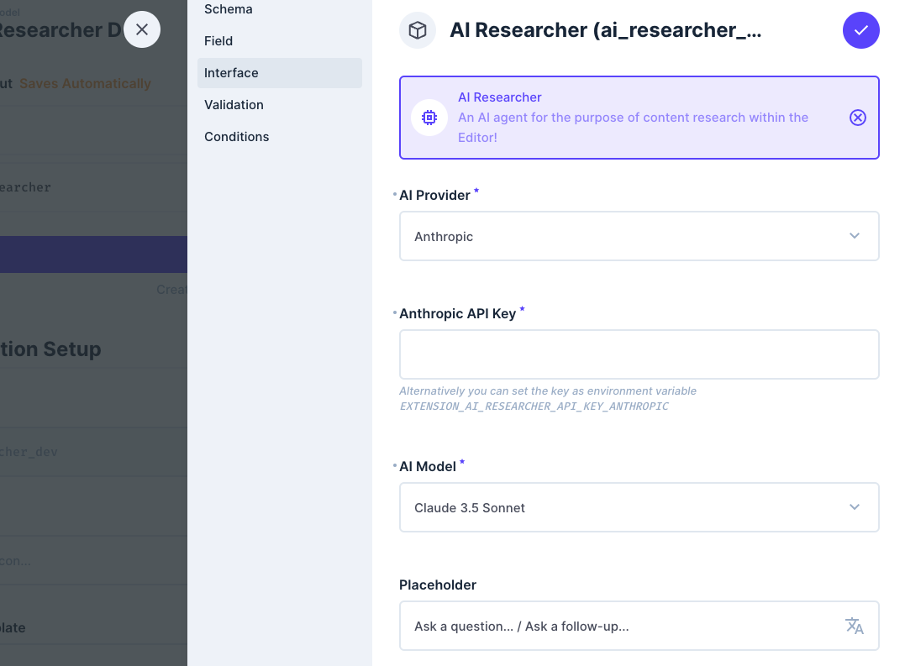

# DEPRECATED

> **This extension has been archived due to low usage and is no longer maintained. It will not receive updates or Directus 12 support.**
> For AI features in Directus, use the built-in [AI Assistant](https://directus.com/docs/guides/ai/assistant) or the [Directus MCP server](https://directus.com/docs/guides/ai/mcp).

---

# AI Researcher
A Directus interface that integrates an AI chatbot powered by OpenAI or Anthropic directly into the Directus editor.






## Features
- Chat with AI directly from your Directus editor
- View the chat history
- Start a new chat

## Prerequisites
- An OpenAI or Anthropic API key

## Installation
To install the extension, take a look at the [official guide](https://docs.directus.io/extensions/installing-extensions.html).

## Configuration



You can select the AI provider and models directly from the interface configuration.

### API-Keys
The API keys can be added either in the interface configuration or via environment variables:

```env
EXTENSION_AI_RESEARCHER_API_KEY_OPENAI="<YOUR_API_KEY>"
EXTENSION_AI_RESEARCHER_API_KEY_ANTHROPIC="<YOUR_API_KEY>"
```

> [!IMPORTANT]  
> If you add the API key via the interface configuration, it will be exposed to your app users. Add them via environment variables to fully hide and protect them.


You can generate your API keys on the following sites:

- [OpenAi](https://platform.openai.com/api-keys)
- [Anthropic](https://console.anthropic.com/settings/workspaces/default/keys)

### Support
For issues and feature requests, please use the GitHub issues section of this repository.