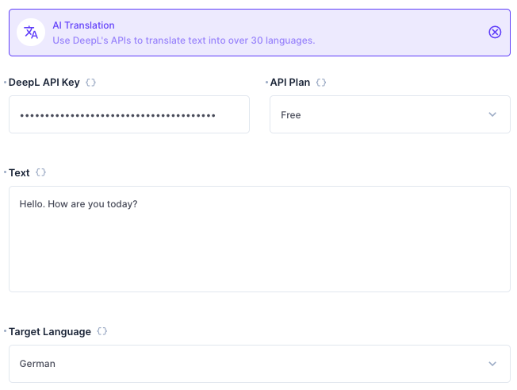

# DEPRECATED

> **This extension is deprecated and no longer maintained. It will not receive updates or Directus 12 support.**
> Use the built-in [AI Text](https://directus.com/docs/guides/flows/operations#ai-text) flow operation instead, and ask it to translate. It works with the providers set in **Settings → AI**.

---

# AI Translator Operation

Translate text into over 30 languages with [DeepL's Translation API](https://deepl.com).

This operation contains four required configuration options - a DeepL API key, an API plan (free/paid) text to translate, and a target language from a dropdown. It returns the translated string with no formatting.

## Output

The output is a single string with the translated text.
