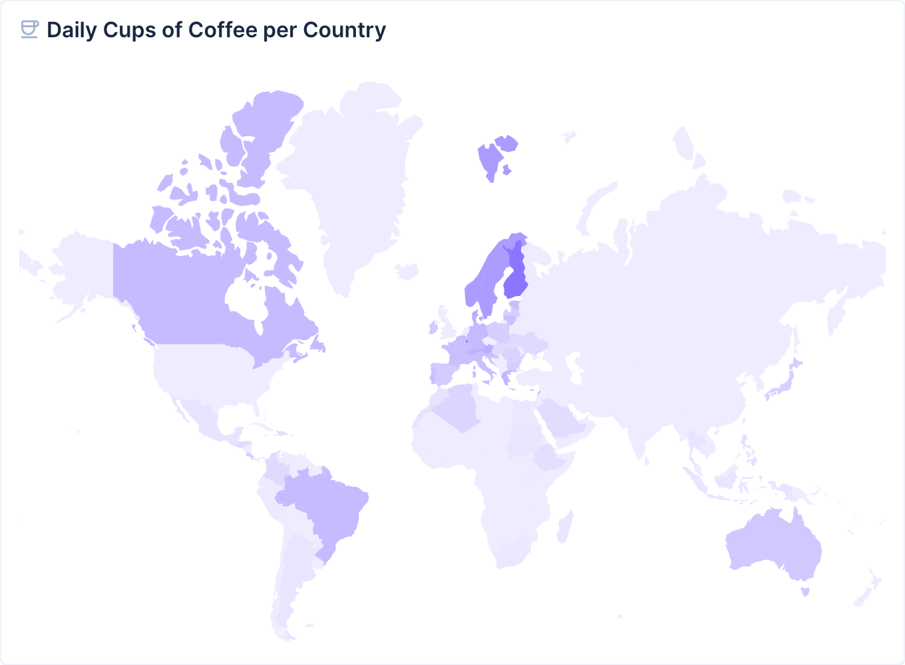

# DEPRECATED

> **This extension has been archived due to low usage and is no longer maintained. It will not receive updates or Directus 12 support.**

---

# Choropleth Map Panel

Add a map panel (powered by [D3](https://d3js.org)) to your dashboard that displays countries in different colors based on their value.

## Installation

Refer to the [Official Guide](https://docs.directus.io/extensions/installing-extensions.html) for details on installing the extension from the Marketplace or manually.

## Usage

Add the Choropleth Map Panel to your Insights Dashboard. In the panel options, select the collection you want to use as data source, then select a Country Field, Aggregated Field and Aggregate Function. The Country Field must be a string field containing either the country name, a 2-letter country code (e.g. US), a 3-letter country code (e.g. USA) or an M49 country code (e.g. 840). You can optionally refine the results with a Filter.