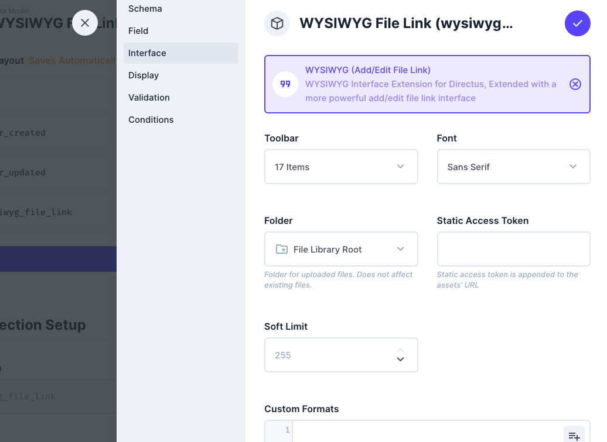
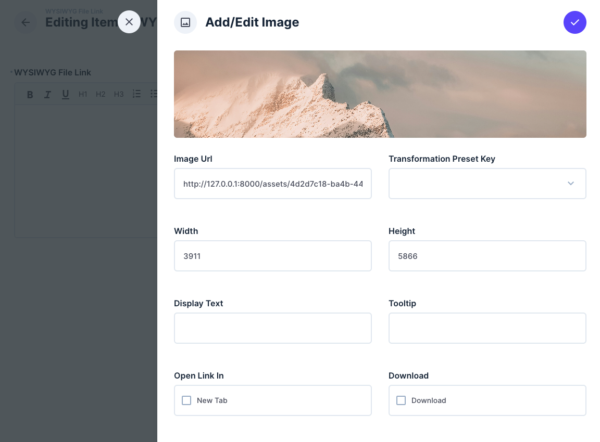
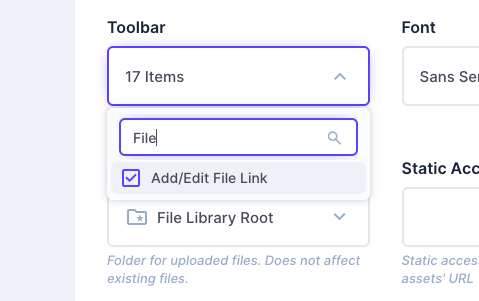

# DEPRECATED

> **This extension has been archived due to low usage and is no longer maintained. It will not receive updates or Directus 12 support.**
> It copies the old TinyMCE-based WYSIWYG interface. Directus 12 uses TipTap. To add features to the WYSIWYG editor, build a [rich text extension](https://directus.com/docs/guides/extensions/app-extensions/richtext).

---

# WYSIWYG (Add/Edit File Link)
An extended WYSIWYG Interface which allows to add links to files.

## Installation
To install the extension, take a look at the [official guide](https://docs.directus.io/extensions/installing-extensions.html).

## Configuration
Simply create a text-field and select the `WYSIWYG (Add/Edit File Link)` interface.

By default the interface will have the newly added `Add/Edit File Link` enabled.

### Support
For issues and feature requests, please use the GitHub issues section of this repository.
